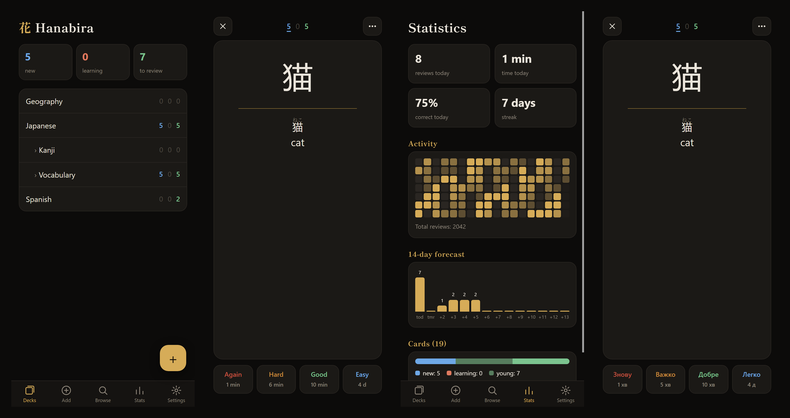

# Hanabira Flashcards 花びら

**Free, offline spaced-repetition flashcards for iPhone and any browser.**
No App Store, no account, no ads, no tracking.

### ▶ Open the app: **https://k1adu.github.io/hanabira/**

[English](#english) · [Українська](#українська)

---

## English

### Features
- **Smart repetition:** rate each card *Again / Hard / Good / Easy*, and each button shows when the card will come back. Learning steps, daily limits and undo are built in.
- **Deck import:** opens `.apkg` / `.colpkg` deck files with images, audio, cloze deletions and furigana. Importing the same deck again only adds the new cards.
- **Your own cards:** create cards with an optional reverse card, use tags and nested decks (`Languages::Japanese`), and search, edit, suspend or postpone them.
- **Text import:** `.txt` / `.csv` / `.tsv` files with `question;answer` per line.
- **Sharing:** export a deck as one file and send it through any messenger. Your friend imports it, and if you later send an updated deck only the new cards are added.
- **Statistics:** daily reviews, accuracy, streak, an activity heatmap, a 14-day forecast and a breakdown of cards by maturity.
- **Text-to-speech:** cards can be read aloud in a chosen language for each deck.
- **6 UI languages:** English, Українська, Polski, Deutsch, Español, 日本語. The language is detected automatically.
- **Works offline:** after the first visit everything runs on the device. There are dark, light and system themes.

### Install
| Device | How |
|---|---|
| **iPhone / iPad** | Open the link in **Safari** → Share ⬆︎ → **Add to Home Screen** |
| **Android** | Open the link in Chrome → ⋮ → **Install app** |
| **Desktop** | Chrome / Edge → install icon in the address bar, or just use the website |

### Your data
- All cards and progress are stored **only on your device**. Nothing is sent to any server.
- There is no cloud sync. Use **Settings → Create backup** from time to time, and restore it with **Import file**.
- On a new phone: back up the old one → send the file to yourself → import it on the new phone.

### Run locally
Plain HTML/CSS/JS with no build step. Run `python -m http.server` in this folder, then open `http://localhost:8000`.

---

## Українська

**Hanabira** (花びら, «пелюстка») — безкоштовні картки з інтервальним повторенням для запам'ятовування. Працюють на iPhone без App Store і без інтернету.

**Встановлення на iPhone:** відкрий **https://k1adu.github.io/hanabira/** у **Safari** → «Поділитися» ⬆︎ → **«На екран „Додому“»**.

**Що вміє**
- Розумне повторення: «Знову / Важко / Добре / Легко», щоденні ліміти, скасування останньої відповіді.
- Імпорт колод (`.apkg`) з картинками, звуком і cloze-картками.
- Власні картки, підколоди, теги, пошук.
- Імпорт тексту (`питання;відповідь`).
- Обмін колодами з друзями через файл: можна надіслати в будь-якому месенджері.
- Статистика, озвучка карток, темна й світла тема, 6 мов інтерфейсу.

**Дані** зберігаються лише на твоєму телефоні. Час від часу роби резервну копію: Налаштування → «Зробити резервну копію».

---

License: [MIT](LICENSE) · Bundled libraries in `lib/` keep their own MIT licenses.
